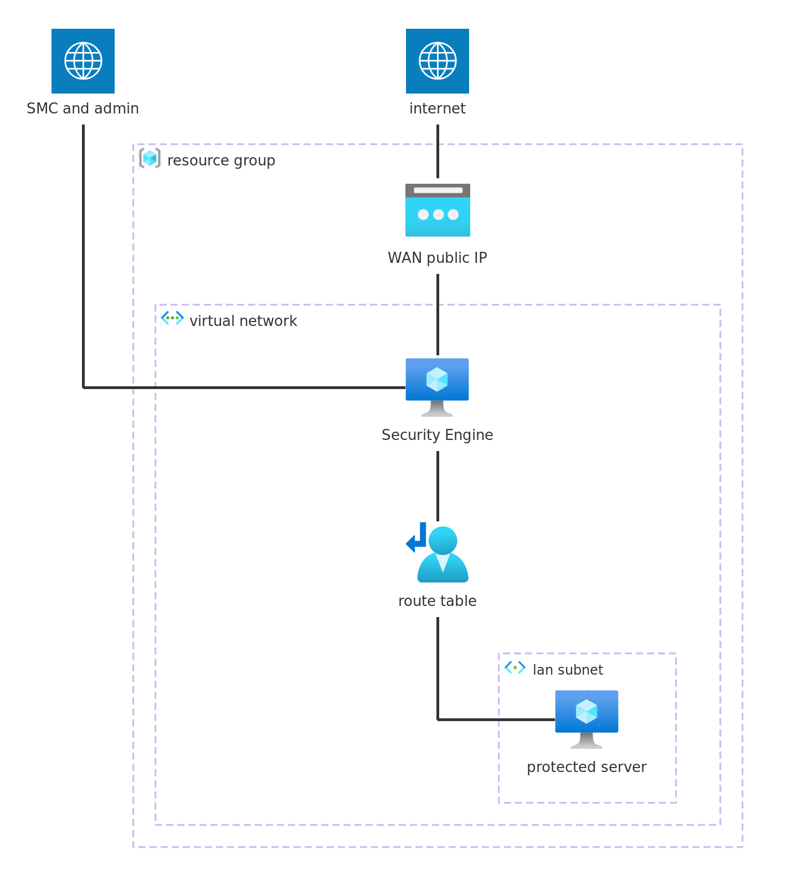

# Single engine, three interfaces

A complete, standalone deployment of one Forcepoint Network Security
Platform Security Engine on Azure. It applies against an empty
subscription: the example creates the resource group, virtual network,
subnets, network security groups, route table and the engine itself, and a
protected test server to verify the forwarding end to end.

The engine is the [`azure-engine`](../../) module, which boots from the
Forcepoint template in the Azure Marketplace; the rest of this directory is
the infrastructure around it. Engine configuration (interfaces, policy,
VPN) lives in the Security Management Center (SMC) and is out of scope:
this example deploys the infrastructure and hands the engine its initial
contact data.



| NIC    | Role       | Public IP | Purpose                                  |
|--------|------------|-----------|------------------------------------------|
| `nic0` | management | yes       | SMC management channel, SSH              |
| `nic1` | lan        | no        | default gateway for the protected subnet |
| `nic2` | wan        | yes       | internet-facing traffic, VPN endpoint    |

## Contents

- [Usage](#usage)
- [Requirements](#requirements)
- [Inputs](#inputs)
- [Outputs](#outputs)
- [Resources](#resources)
- [Routing](#routing)
- [Verifying](#verifying)
- [Access to the protected server](#access-to-the-protected-server)

## Usage

```bash
terraform init

cp terraform.tfvars.example terraform.tfvars
$EDITOR terraform.tfvars       # resource_group_name, allowed CIDRs, keys
terraform apply
```

## Requirements

| Requirement                  | Detail                                           |
|------------------------------|--------------------------------------------------|
| Terraform                    | >= 1.9                                           |
| `hashicorp/azurerm` provider | >= 4.0, < 6.0, pulled in by the module           |
| Azure credentials            | For example through `az login`                   |
| Marketplace offer            | Terms accepted in the subscription               |
| SMC                          | Reachable from `nic0`, for an SMC-managed engine |

Accept the template's terms before the first apply, or the engine fails to
create with a message pointing at the marketplace offer:

```bash
az vm image terms accept --publisher forcepoint-llc \
  --offer forcepoint-ngfw --plan ngfw_payg
```

## Inputs

| Name                                  | Description                                                                                                      | Type           | Default           | Required |
|---------------------------------------|------------------------------------------------------------------------------------------------------------------|----------------|-------------------|----------|
| `admin_username`                      | Login the `ssh_public_keys` grant access as on the engine.                                                       | `string`       | `"azure"`         | no       |
| [`allowed_cidrs`](#allowed_cidrs)     | Sources permitted to reach the management and WAN interfaces: the SMC, your administrative networks, VPN peers.  | `list(string)` | n/a               | **yes**  |
| `bastion_subnet_cidr`                 | CIDR of the `AzureBastionSubnet`; at least a /26.                                                                | `string`       | `"10.0.200.0/26"` | no       |
| `enable_bastion`                      | Deploy Azure Bastion for access to the protected server; it bills from deployment.                               | `bool`         | `false`           | no       |
| `enable_control_bypass`               | Bypass the engine for workload traffic to `allowed_cidrs`, so they stay reachable when the engine is down.       | `bool`         | `true`            | no       |
| `engine_image_version`                | Template version the engine boots from.                                                                          | `string`       | `"7.3.5"`         | no       |
| [`initial_contact`](#initial_contact) | Initial contact data for the engine. Sensitive. `null` boots an unconfigured engine.                             | `string`       | `null`            | no       |
| `lan_cidr`                            | CIDR of the LAN subnet (`nic1`), where protected workloads live.                                                 | `string`       | `"10.0.1.0/24"`   | no       |
| `location`                            | Azure location to deploy into. The networks and the engine are created in it.                                    | `string`       | `"westeurope"`    | no       |
| `management_cidr`                     | CIDR of the management subnet (`nic0`).                                                                          | `string`       | `"10.0.0.0/24"`   | no       |
| `name`                                | Name prefix for every resource, and the name of the engine virtual machine.                                      | `string`       | `"example"`       | no       |
| `resource_group_name`                 | Name of the resource group for the example. Created by it; `destroy` removes it with everything in it.           | `string`       | n/a               | **yes**  |
| `server_machine_type`                 | Virtual machine size for the protected test server.                                                              | `string`       | `"Standard_B1s"`  | no       |
| `server_user`                         | Login the `ssh_public_keys` are installed for on the test server.                                                | `string`       | `"azureuser"`     | no       |
| `size`                                | Virtual machine size for the engine. See the template's marketplace listing for supported sizes.                 | `string`       | `"Standard_B4ms"` | no       |
| `ssh_public_keys`                     | Public keys in OpenSSH format, installed for `admin_username` on the engine and for `server_user` on the server. | `list(string)` | n/a               | **yes**  |
| `vnet_cidr`                           | CIDR of the virtual network.                                                                                     | `string`       | `"10.0.0.0/16"`   | no       |
| `wan_cidr`                            | CIDR of the WAN subnet (`nic2`).                                                                                 | `string`       | `"10.0.100.0/24"` | no       |

### `initial_contact`

Optional. Initial contact data, passed straight to the module. The engine
reads it on first boot and contacts the SMC, which then shows the engine
as online. Leave it unset to boot an unconfigured engine, and configure it
later over the console with `sg-reconfigure`.

Produce it by creating the engine element in the SMC and saving its initial
configuration. The file carries a one-time password with limited validity,
so generate it close to the apply.

For cloud-initiated contact, where the engine creates its own SMC element
over the SMC API, pass a JSON document instead of an `engine.cfg`. See the
[`initial_contact`](../../README.md#initial_contact) input in the module
README for the format.

### `allowed_cidrs`

Required, with no default: an open management interface is not a sensible
default for an engine. The rules allow every protocol and port from these
ranges, so the list is the only thing between the management and WAN
interfaces and the rest of the internet. Keep it tight.

It must contain the SMC's address, the addresses you administer the engine
from, and any VPN peer the engine terminates.

## Outputs

| Name                   | Description                                                                      |
|------------------------|----------------------------------------------------------------------------------|
| `management_public_ip` | Public address of `nic0`: the SMC contact address, and the SSH target.           |
| `network_interfaces`   | Per-interface index, subnet and addresses, keyed by NIC name.                    |
| `resource_group_id`    | ID of the resource group.                                                        |
| `bastion_ssh_command`  | `az network bastion ssh` command for the protected server, over Bastion.         |
| `server_internal_ip`   | Private address of the protected test server.                                    |
| `server_ssh_command`   | `ssh` command for the protected test server.                                     |
| `ssh_command`          | `ssh` command for the engine's management interface.                             |
| `subnets`              | IDs of the three subnets, keyed by role.                                         |
| `virtual_network_id`   | ID of the virtual network.                                                       |
| `wan_public_ip`        | Public address of `nic2`, the WAN interface, for example the local VPN endpoint. |

## Resources

| Resource                                                                                                                                                                           | Type     | Created when                    |
|------------------------------------------------------------------------------------------------------------------------------------------------------------------------------------|----------|---------------------------------|
| [`azurerm_resource_group.this`](https://registry.terraform.io/providers/hashicorp/azurerm/latest/docs/resources/resource_group)                                                    | resource | always                          |
| [`azurerm_virtual_network.this`](https://registry.terraform.io/providers/hashicorp/azurerm/latest/docs/resources/virtual_network)                                                  | resource | always                          |
| [`azurerm_subnet.this`](https://registry.terraform.io/providers/hashicorp/azurerm/latest/docs/resources/subnet)                                                                    | resource | three, one per engine interface |
| [`azurerm_network_security_group.management`](https://registry.terraform.io/providers/hashicorp/azurerm/latest/docs/resources/network_security_group)                              | resource | always                          |
| [`azurerm_network_security_group.wan`](https://registry.terraform.io/providers/hashicorp/azurerm/latest/docs/resources/network_security_group)                                     | resource | always                          |
| [`azurerm_network_security_group.lan`](https://registry.terraform.io/providers/hashicorp/azurerm/latest/docs/resources/network_security_group)                                     | resource | always                          |
| [`azurerm_subnet_network_security_group_association.*`](https://registry.terraform.io/providers/hashicorp/azurerm/latest/docs/resources/subnet_network_security_group_association) | resource | three, one per subnet           |
| [`azurerm_route_table.lan`](https://registry.terraform.io/providers/hashicorp/azurerm/latest/docs/resources/route_table)                                                           | resource | always                          |
| [`azurerm_subnet_route_table_association.lan`](https://registry.terraform.io/providers/hashicorp/azurerm/latest/docs/resources/subnet_route_table_association)                     | resource | always                          |
| [`azurerm_subnet.bastion`](https://registry.terraform.io/providers/hashicorp/azurerm/latest/docs/resources/subnet)                                                                 | resource | when `enable_bastion` is set    |
| [`azurerm_public_ip.bastion`](https://registry.terraform.io/providers/hashicorp/azurerm/latest/docs/resources/public_ip)                                                           | resource | when `enable_bastion` is set    |
| [`azurerm_bastion_host.this`](https://registry.terraform.io/providers/hashicorp/azurerm/latest/docs/resources/bastion_host)                                                        | resource | when `enable_bastion` is set    |
| [`azurerm_public_ip.server`](https://registry.terraform.io/providers/hashicorp/azurerm/latest/docs/resources/public_ip)                                                            | resource | always                          |
| [`azurerm_network_interface.server`](https://registry.terraform.io/providers/hashicorp/azurerm/latest/docs/resources/network_interface)                                            | resource | always                          |
| [`azurerm_linux_virtual_machine.server`](https://registry.terraform.io/providers/hashicorp/azurerm/latest/docs/resources/linux_virtual_machine)                                    | resource | always                          |

The engine itself is created by the [`azure-engine`](../../) module; its
resources are listed in the [module README](../../README.md#resources).

## Routing

The route table attaches to the LAN subnet only: workloads there send their
egress through the engine's LAN interface. The management subnet keeps its
direct path to the SMC: it has no route table.

Each range in `allowed_cidrs` gets a dedicated route, to the internet next
hop. The workloads' traffic to the administrative networks then bypasses
the engine, so the workloads stay reachable from there when the engine is
down; `enable_control_bypass` controls it, on by default.

With Bastion deployed, its subnet gets a dedicated route, to the virtual
network itself. The Bastion data plane sits in that subnet and sources from
within it, so without the route the workloads' replies to it would follow
the default route through the engine, and Bastion would die with the engine.

## Verifying

```bash
terraform output management_public_ip   # contacted by the SMC
terraform output wan_public_ip          # traffic side, e.g. VPN endpoint
```

The engine appears as online in the SMC once initial contact completes.
If it does not, connect over SSH (or the serial console) and read the boot
log.

## Access to the protected server

The example protected server has a public address, for verifying the route
end to end. Reach it directly with:

```bash
$(terraform output -raw server_ssh_command)
```

Its default egress goes through the engine; check from the server that
outbound traffic leaves via the engine's WAN interface. SSH to it from the
`allowed_cidrs` does not need the engine up: the bypass routes keep the
server reachable from there when the engine is down.

For access that does not depend on your own address, set
`enable_bastion = true`: the example deploys Azure Bastion, which brokers SSH
over the portal or the native client, with no port 22 open to the internet.
The dedicated route above keeps it working when the engine is down:

```bash
$(terraform output -raw bastion_ssh_command)
```

If the CLI prompts, it is asking for the private key file; pass it with
`--ssh-key`, for example `--ssh-key ~/.ssh/id_ed25519`.

If the engine itself is unreachable, use its serial console:
`az serial-console connect --resource-group <rg> --name <engine>`. It works with
the network down. The boot diagnostics the module enables by default store
the serial output and screenshots of the first boot.

Bastion bills from deployment, regardless of use: leave `enable_bastion` off when
you do not need it.

## Support

These modules are provided as-is and support is best effort based. For the
product itself, refer to your Forcepoint support agreement.

## License

Apache 2.0, see [LICENSE](../../../../LICENSE).
