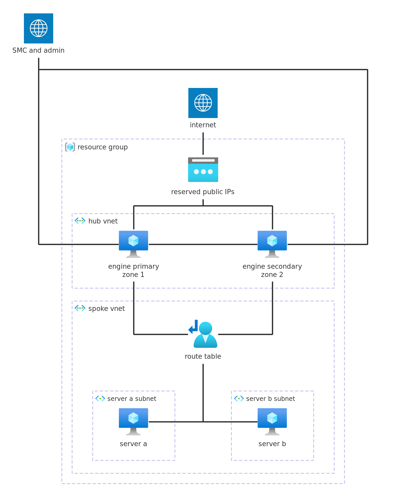

# Standby HA pair, two zones

A complete, standalone deployment of a standby HA pair of Forcepoint Network
Security Platform Security Engines on Azure. The two engines share a hub
virtual network, in different availability zones; each protected server
lives in its own subnet of the spoke virtual network, peered to the hub. It
applies against an empty subscription: the example creates the resource
group, the hub and spoke virtual networks, the subnets, the peerings,
network security groups, the route table, the pair's reserved public
IPs, the failover identity and the engines.

The engines are the [`azure-engine`](../../) module, which boots from the
Forcepoint template in the Azure Marketplace; the rest of this directory is
the infrastructure around them. The SMC-side configuration (the pair, the
failover script, the VPN and DNAT policy) lives in the SMC and is out of
scope. What the example does hand over is everything the cloud HA failover
script needs: the `FP_HA_` tags on the engines, the reserved public IPs and
the identity the script runs under. See [Failover](#failover).



The failover script moves the reserved public IPs and the route table's
next hop to the active engine.

Per engine:

| NIC    | Role       | Public IP                                                                                    | Purpose                                                   |
|--------|------------|----------------------------------------------------------------------------------------------|-----------------------------------------------------------|
| `nic0` | management | module-created, zonal                                                                        | SMC management channel, SSH                               |
| `nic1` | lan        | none                                                                                         | next hop of the servers' default route                    |
| `nic2` | wan        | `vpn` on the primary configuration; `weba` and `webb` on the two secondary IP configurations | security-hub ingress: PBVPN endpoint, DNAT to the servers |

The `weba` and `webb` public IPs terminate on secondary IP configurations of
the WAN interface, so the engines need no separate NICs for them.

## Contents

- [Usage](#usage)
- [Requirements](#requirements)
- [Inputs](#inputs)
- [Outputs](#outputs)
- [Resources](#resources)
- [Routing](#routing)
- [Failover](#failover)
- [Tearing down](#tearing-down)
- [Verifying](#verifying)
- [Access to the protected servers](#access-to-the-protected-servers)

## Usage

```bash
terraform init

cp terraform.tfvars.example terraform.tfvars
$EDITOR terraform.tfvars       # resource_group_name, allowed CIDRs, keys
terraform apply
```

The failover identity's role definition can take around half an hour to
propagate. Start the failover script after it has, so the script's first
Azure API calls do not fail on a missing role.

## Requirements

| Requirement                  | Detail                                           |
|------------------------------|--------------------------------------------------|
| Terraform                    | >= 1.9                                           |
| `hashicorp/azurerm` provider | >= 4.0, < 6.0, pulled in by the module           |
| Azure credentials            | For example through `az login`                   |
| Marketplace offer            | Terms accepted in the subscription               |
| SMC                          | Reachable from `nic0`, for an SMC-managed engine |

Accept the template's terms before the first apply, or the engines fail to
create with a message pointing at the marketplace offer:

```bash
az vm image terms accept --publisher forcepoint-llc \
  --offer forcepoint-ngfw --plan ngfw_payg
```

## Inputs

| Name                                                                                  | Description                                                                                                        | Type           | Default           | Required |
|---------------------------------------------------------------------------------------|--------------------------------------------------------------------------------------------------------------------|----------------|-------------------|----------|
| `admin_username`                                                                      | Login the `ssh_public_keys` grant access as on the engines.                                                        | `string`       | `"azure"`         | no       |
| [`allowed_cidrs`](#allowed_cidrs)                                                     | Sources permitted to reach the management interfaces and to open SSH to the servers.                               | `list(string)` | n/a               | **yes**  |
| `enable_control_bypass`                                                               | Bypass the engines for the servers' traffic to `allowed_cidrs`, so they stay reachable when an engine is down.     | `bool`         | `true`            | no       |
| `enable_ha_identity`                                                                  | Create the failover identity and its resource-group-scoped role, and attach the identity to both engines.          | `bool`         | `true`            | no       |
| `engine_image_version`                                                                | Template version the engines boot from.                                                                            | `string`       | `"7.3.5"`         | no       |
| `hub_vnet_cidr`                                                                       | CIDR of the hub virtual network, which holds the engines' subnets.                                                 | `string`       | `"10.0.0.0/16"`   | no       |
| [`initial_contact_primary`](#initial_contact_primary-and-initial_contact_secondary)   | Initial contact data for the primary engine. Sensitive. `null` boots an unconfigured engine.                       | `string`       | `null`            | no       |
| [`initial_contact_secondary`](#initial_contact_primary-and-initial_contact_secondary) | Initial contact data for the secondary engine. Sensitive. `null` boots an unconfigured engine.                     | `string`       | `null`            | no       |
| `lan_cidr`                                                                            | CIDR of the LAN subnet (`nic1`), inside `hub_vnet_cidr`.                                                           | `string`       | `"10.0.1.0/24"`   | no       |
| `location`                                                                            | Azure location to deploy into. The networks and the engines are created in it.                                     | `string`       | `"westeurope"`    | no       |
| `management_cidr`                                                                     | CIDR of the management subnet (`nic0`), inside `hub_vnet_cidr`.                                                    | `string`       | `"10.0.0.0/24"`   | no       |
| `name`                                                                                | Name prefix for the example's resources; the engines are `<name>-primary` and `<name>-secondary`.                  | `string`       | `"example"`       | no       |
| `resource_group_name`                                                                 | Name of the resource group for the example. Created by it; `destroy` removes it with everything in it.             | `string`       | n/a               | **yes**  |
| `resource_group_tags`                                                                 | Tags applied to the resource group.                                                                                | `map(string)`  | `{}`              | no       |
| `server_machine_type`                                                                 | Virtual machine size for the servers.                                                                              | `string`       | `"Standard_B1s"`  | no       |
| `server_user`                                                                         | Login the `ssh_public_keys` are installed for on the servers.                                                      | `string`       | `"azureuser"`     | no       |
| `size`                                                                                | Virtual machine size for the engines. See the template's marketplace listing for supported sizes.                  | `string`       | `"Standard_B4ms"` | no       |
| `spoke_a_subnet_cidr`                                                                 | CIDR of the server a subnet, inside `spoke_vnet_cidr`.                                                             | `string`       | `"10.1.0.0/24"`   | no       |
| `spoke_b_subnet_cidr`                                                                 | CIDR of the server b subnet, inside `spoke_vnet_cidr`.                                                             | `string`       | `"10.1.1.0/24"`   | no       |
| `spoke_vnet_cidr`                                                                     | CIDR of the spoke virtual network, which holds the servers' subnets.                                               | `string`       | `"10.1.0.0/16"`   | no       |
| `ssh_public_keys`                                                                     | Public keys in OpenSSH format, installed for `admin_username` on the engines and for `server_user` on the servers. | `list(string)` | n/a               | **yes**  |
| `wan_cidr`                                                                            | CIDR of the WAN subnet (`nic2`), inside `hub_vnet_cidr`; at least /27, the engines pin hosts 10 through 15 in it.  | `string`       | `"10.0.100.0/24"` | no       |
| `zone_primary`                                                                        | Availability zone for the primary engine.                                                                          | `number`       | `1`               | no       |
| `zone_secondary`                                                                      | Availability zone for the secondary engine; must differ from `zone_primary`.                                       | `number`       | `2`               | no       |

### `initial_contact_primary` and `initial_contact_secondary`

Optional, one document per engine, passed straight to the module. The
engines read them on first boot and contact the SMC, which then shows the
engines as online. Leave them unset to boot unconfigured engines, and
configure them later over the console with `sg-reconfigure`.

Produce each document by creating the engine element in the SMC and saving
its initial configuration. The files carry a one-time password with limited
validity, so generate them close to the apply.

For cloud-initiated contact, where the engine creates its own SMC element
over the SMC API, pass a JSON document instead of an `engine.cfg`. See the
[`initial_contact`](../../README.md#initial_contact) input in the module
README for the format.

### `allowed_cidrs`

Required, with no default: an open management interface is not a sensible
default for an engine. The management rules allow every protocol and port
from these ranges, so the list is the only thing between the management
interfaces and the rest of the internet. Keep it tight.

It must contain the SMC's address and the addresses you administer the
engines from. The WAN interface is open to the internet by design: it is
the security hub's entry, and the engine's policy is the filter. It is also
the VPN endpoint, so include any VPN peer you terminate on it.

## Outputs

| Name                     | Description                                                                                     |
|--------------------------|-------------------------------------------------------------------------------------------------|
| `engine_ids`             | Resource ID of each engine virtual machine.                                                     |
| `ha_tags`                | The `FP_HA_` tags the failover script reads from the engines.                                   |
| `identity`               | The failover identity: ID, client ID and principal ID; `null` when `enable_ha_identity` is off. |
| `management_public_ips`  | Public address of each engine's management interface: the SMC contact addresses.                |
| `reserved_public_ip_ids` | Resource ID of each reserved public IP, keyed `vpn`, `weba` and `webb`.                         |
| `reserved_public_ips`    | Public IPv4 address of each reserved public IP, keyed `vpn`, `weba` and `webb`.                 |
| `resource_group_id`      | ID of the resource group.                                                                       |
| `route_table`            | Resource ID of the servers' shared route table.                                                 |
| `server_internal_ips`    | Private address of each server, keyed `a` and `b`.                                              |
| `server_ssh_commands`    | `ssh` commands for the servers.                                                                 |
| `ssh_commands`           | `ssh` commands for the engines' management interfaces.                                          |
| `subnets`                | IDs of the hub and the spoke subnets.                                                           |
| `virtual_networks`       | IDs of the hub and the spoke virtual network.                                                   |

## Resources

| Resource                                                                                                                                                                           | Type     | Created when                     |
|------------------------------------------------------------------------------------------------------------------------------------------------------------------------------------|----------|----------------------------------|
| [`azurerm_resource_group.this`](https://registry.terraform.io/providers/hashicorp/azurerm/latest/docs/resources/resource_group)                                                    | resource | always                           |
| [`azurerm_virtual_network.hub`](https://registry.terraform.io/providers/hashicorp/azurerm/latest/docs/resources/virtual_network)                                                   | resource | always                           |
| [`azurerm_virtual_network.spoke`](https://registry.terraform.io/providers/hashicorp/azurerm/latest/docs/resources/virtual_network)                                                 | resource | always                           |
| [`azurerm_subnet.hub`](https://registry.terraform.io/providers/hashicorp/azurerm/latest/docs/resources/subnet)                                                                     | resource | three, one per engine interface  |
| [`azurerm_subnet.spoke`](https://registry.terraform.io/providers/hashicorp/azurerm/latest/docs/resources/subnet)                                                                   | resource | two, one per server              |
| [`azurerm_virtual_network_peering.hub_to_spoke`](https://registry.terraform.io/providers/hashicorp/azurerm/latest/docs/resources/virtual_network_peering)                          | resource | always                           |
| [`azurerm_virtual_network_peering.spoke_to_hub`](https://registry.terraform.io/providers/hashicorp/azurerm/latest/docs/resources/virtual_network_peering)                          | resource | always                           |
| [`azurerm_network_security_group.management`](https://registry.terraform.io/providers/hashicorp/azurerm/latest/docs/resources/network_security_group)                              | resource | always                           |
| [`azurerm_network_security_group.lan`](https://registry.terraform.io/providers/hashicorp/azurerm/latest/docs/resources/network_security_group)                                     | resource | always                           |
| [`azurerm_network_security_group.wan`](https://registry.terraform.io/providers/hashicorp/azurerm/latest/docs/resources/network_security_group)                                     | resource | always                           |
| [`azurerm_network_security_group.server_a`](https://registry.terraform.io/providers/hashicorp/azurerm/latest/docs/resources/network_security_group)                                | resource | always                           |
| [`azurerm_network_security_group.server_b`](https://registry.terraform.io/providers/hashicorp/azurerm/latest/docs/resources/network_security_group)                                | resource | always                           |
| [`azurerm_subnet_network_security_group_association.*`](https://registry.terraform.io/providers/hashicorp/azurerm/latest/docs/resources/subnet_network_security_group_association) | resource | five, one per subnet             |
| [`azurerm_route_table.spoke`](https://registry.terraform.io/providers/hashicorp/azurerm/latest/docs/resources/route_table)                                                         | resource | always, one for both subnets     |
| [`azurerm_subnet_route_table_association.spoke`](https://registry.terraform.io/providers/hashicorp/azurerm/latest/docs/resources/subnet_route_table_association)                   | resource | two, one per subnet              |
| [`azurerm_public_ip.ha`](https://registry.terraform.io/providers/hashicorp/azurerm/latest/docs/resources/public_ip)                                                                | resource | three: `vpn`, `weba`, `webb`     |
| [`azurerm_user_assigned_identity.ha`](https://registry.terraform.io/providers/hashicorp/azurerm/latest/docs/resources/user_assigned_identity)                                      | resource | when `enable_ha_identity` is set |
| [`azurerm_role_definition.ha`](https://registry.terraform.io/providers/hashicorp/azurerm/latest/docs/resources/role_definition)                                                    | resource | when `enable_ha_identity` is set |
| [`azurerm_role_assignment.ha`](https://registry.terraform.io/providers/hashicorp/azurerm/latest/docs/resources/role_assignment)                                                    | resource | when `enable_ha_identity` is set |
| [`azurerm_public_ip.server`](https://registry.terraform.io/providers/hashicorp/azurerm/latest/docs/resources/public_ip)                                                            | resource | two, one per server              |
| [`azurerm_network_interface.server`](https://registry.terraform.io/providers/hashicorp/azurerm/latest/docs/resources/network_interface)                                            | resource | two, one per server              |
| [`azurerm_linux_virtual_machine.server`](https://registry.terraform.io/providers/hashicorp/azurerm/latest/docs/resources/linux_virtual_machine)                                    | resource | two, one per server              |

The engines themselves are created by the [`azure-engine`](../../) module;
their resources are listed in the [module README](../../README.md#resources).

## Routing

The spoke virtual network carries one route table, associated with both
server subnets: a route table can serve several subnets of one virtual
network, so the failover rewrites a single table. Its default route points
at the primary engine's LAN address, with next hop type
`VirtualAppliance`: the servers' egress goes through the engines, and the
engine's policy decides what happens to it. The hub's subnets carry no
route table: the engines' own control traffic takes the direct path.

Each range in `allowed_cidrs` gets a dedicated route, to the internet next
hop. The servers' traffic to the administrative networks then bypasses the
engines, so the servers stay reachable from there when an engine is down;
`enable_control_bypass` controls it, on by default.

The route table's next hop is managed at run time: on failover the
failover script rewrites it to the secondary engine's LAN address. A
`terraform apply` resets it to the primary, and the script re-asserts the
active engine on its next check.

Traffic between the two server subnets stays inside the spoke virtual
network: a route table steers only traffic leaving the virtual network, so
same-vnet flows take the platform's direct route instead of the engines'.
The per-subnet network security groups deny those flows anyway: each
server subnet accepts SSH from `allowed_cidrs` and traffic from the hub
only. If your workloads must be gated by
the engines on every path, give each server its own virtual network
instead: then all traffic, including server-to-server, transits the
engines.

## Failover

The example prepares the Azure side of the failover. Pairing the engines,
installing the failover script and writing the VPN and DNAT policy happen
in the SMC. The failover script, [Forcepoint's
`fp-NGFW-Azure-ha`](https://github.com/Forcepoint/fp-NGFW-Azure-ha), runs
on the engines: the secondary probes the primary, and when the primary
fails it moves the reserved public IPs and the route table to itself.

A `terraform apply` detaches the reserved public IPs from the active
engine, as they are not in the configuration of its interfaces; the script
reattaches them on its next check.

### What the example hands over

| Setting                                                              | Value                                                                 | Used for                                                     |
|----------------------------------------------------------------------|-----------------------------------------------------------------------|--------------------------------------------------------------|
| `FP_HA_route_table_id` (tag on both engines)                         | the spoke route table's ID                                            | rewriting the next hop on failover                           |
| `FP_HA_internal_nic_idx` (tag on both engines)                       | `1`, the LAN interface's index                                        | where the route table's next hop points                      |
| `FP_HA_primary_instance_id`, `FP_HA_secondary_instance_id`           | the engines' virtual machine resource IDs                             | telling the engines apart                                    |
| `FP_HA_reserved_public_ip_vpn` / `_weba` / `_webb`                   | `public IP address,primary private address,secondary private address` | attaching and moving each public IP                          |
| `azurerm_public_ip.ha`                                               | the three reserved public IPs, unattached                             | `vpn`: the PBVPN endpoint; `weba`/`webb`: the DNAT addresses |
| `azurerm_user_assigned_identity.ha` and `azurerm_role_definition.ha` | the identity and its resource-group-scoped role                       | the script's Azure API calls                                 |

The script reads these settings from the engines' tags, which take
precedence over SMC custom properties. The only SMC-side setting it still
needs is `se_script_path`, in a custom properties profile.

### In the SMC (out of scope)

1. Define the pair: both engines, with the same interface definitions on
   both: three interfaces, and on the WAN interface the `weba` and `webb`
   secondary addresses as well.
2. The policy: the policy-based VPN on the `vpn` address, DNAT rules from
   `weba` to server a and `webb` to server b, and a rule that lets the
   secondary probe the primary's LAN address over TCP port 22.
3. A custom properties profile with `se_script_path` pointing at the
   failover script.
4. Start the script on both engines, after the role definition has
   propagated.

Failback is manual: bring the primary back online with the product's
failback command, for example `sg-cluster online`, and the script moves
the public IPs and the route table back.

## Tearing down

The failover script attaches the reserved public IPs to the engines' WAN
interfaces outside of Terraform, and the attachment is not in the state.
The engines depend on the reserved public IPs, so `terraform destroy`
deletes the engines' network interfaces, and the attachments with them,
before it deletes the public IPs.

## Verifying

```bash
terraform output management_public_ips   # contacted by the SMC
terraform output reserved_public_ips     # vpn, weba and webb
```

The engines appear as online in the SMC once initial contact completes. If
one does not, connect over SSH with `ssh_commands` and read the boot log.

To exercise the failover, stop the primary engine in Azure and watch the
reserved public IPs move to the secondary, and the route table rewrite
itself; the servers' egress keeps flowing through the pair.

## Access to the protected servers

The servers have public addresses, for verifying the route end to end.
Reach them directly with:

```bash
$(terraform output -raw server_ssh_commands)
```

Their default egress goes through the engines; check from a server that
outbound traffic leaves via the engine's WAN interface. SSH to them from
the `allowed_cidrs` does not need the engines up: the bypass routes keep
the servers reachable from there when an engine is down.

The `weba` and `webb` addresses are the production ingress: once the DNAT
policy is in place in the SMC, the service you front on each one reaches
server a and server b through the engine's policy.

## Support

These modules are provided as-is and support is best effort based. For the
product itself, refer to your Forcepoint support agreement.

## License

Apache 2.0, see [LICENSE](../../../../LICENSE).
