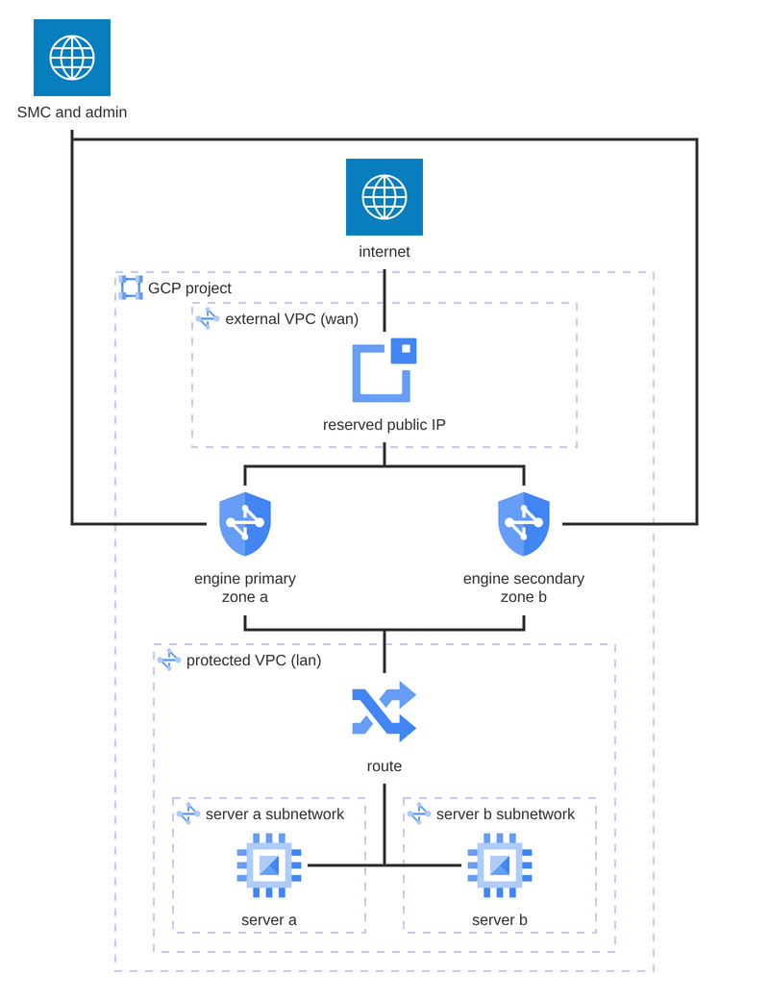

# Standby HA pair, two zones

A complete, standalone deployment of a standby HA pair of Forcepoint Network
Security Platform Security Engines on Google Cloud. The two engines share
the management, LAN and WAN networks, in different zones of one region;
each protected server lives in its own subnetwork of the LAN network. It
applies against an empty GCP project: the example creates the networks,
the subnetworks, the reserved addresses, firewall rules, the route, the
WAN public IPs, the failover service account and the engines.

The engines are the [`gcp-engine`](../../) module, which boots from an
engine image imported into the project; the rest of this directory is the
infrastructure around them. The SMC-side configuration (the pair, the
failover script, the VPN policy) lives in the SMC and is out of scope.
What the example does hand over is everything the cloud HA failover script
needs: the `FP_HA_` metadata on the engines, the WAN public IPs and the
service account the script runs under. See [Failover](#failover).



The failover script moves the floating IP and the servers' route to the
active engine. See [`wan_floating_ip`](#wan_floating_ip).

Per engine:

| NIC    | Role       | Public IP                                | Purpose                                |
|--------|------------|------------------------------------------|----------------------------------------|
| `nic0` | management | reserved, per engine                     | SMC management channel, SSH            |
| `nic1` | lan        | none                                     | next hop of the servers' default route |
| `nic2` | wan        | `vpn`, floating, or reserved, per engine | internet ingress: VPN endpoint         |

## Contents

- [Usage](#usage)
- [Requirements](#requirements)
- [Inputs](#inputs)
- [Outputs](#outputs)
- [Resources](#resources)
- [Routing](#routing)
- [Failover](#failover)
- [Tearing down](#tearing-down)
- [Verifying](#verifying)
- [Access to the protected servers](#access-to-the-protected-servers)

## Usage

```bash
terraform init

cp terraform.tfvars.example terraform.tfvars
$EDITOR terraform.tfvars       # project_id, image, allowed CIDRs, keys
terraform apply
```

The failover service account's role binding can take a few minutes to
propagate. Start the failover script after it has, so the script's first
Google Cloud API calls do not fail on a missing permission.

## Requirements

| Requirement                 | Detail                                                      |
|-----------------------------|-------------------------------------------------------------|
| Terraform                   | >= 1.9                                                      |
| `hashicorp/google` provider | >= 6.0, < 9.0, pulled in by the module                      |
| Google Cloud credentials    | For example through `gcloud auth application-default login` |
| Engine image                | Imported into the project, outside of Terraform             |
| APIs                        | `compute`, `iam` and `iap` enabled                          |
| SMC                         | Reachable from `nic0`, for an SMC-managed engine            |

Import the engine image, see [`image`](#image), and enable the APIs before
the first apply:

```bash
gcloud services enable compute.googleapis.com iam.googleapis.com \
  iap.googleapis.com --project my-project
```

The identity running Terraform needs `roles/compute.admin`,
`roles/iam.roleAdmin`, `roles/iam.serviceAccountAdmin`,
`roles/iam.serviceAccountUser` and `roles/resourcemanager.projectIamAdmin`
in the project, or the equivalent permissions. SSH to the servers needs
`roles/iap.tunnelResourceAccessor`.

## Inputs

| Name                                                                                  | Description                                                                                                              | Type           | Default                    | Required |
|---------------------------------------------------------------------------------------|--------------------------------------------------------------------------------------------------------------------------|----------------|----------------------------|----------|
| [`allowed_cidrs`](#allowed_cidrs)                                                     | Sources permitted to reach the management interfaces and the servers: SMC, admins, VPN peer sites.                       | `list(string)` | n/a                        | **yes**  |
| `enable_ha_identity`                                                                  | Create the failover service account and its project-scoped role, and attach the service account to both engines.         | `bool`         | `true`                     | no       |
| [`image`](#image)                                                                     | Self-link or name of the engine image the engines boot from.                                                             | `string`       | n/a                        | **yes**  |
| [`initial_contact_primary`](#initial_contact_primary-and-initial_contact_secondary)   | Initial contact data for the primary engine. Sensitive. `null` boots an unconfigured engine.                             | `string`       | `null`                     | no       |
| [`initial_contact_secondary`](#initial_contact_primary-and-initial_contact_secondary) | Initial contact data for the secondary engine. Sensitive. `null` boots an unconfigured engine.                           | `string`       | `null`                     | no       |
| `lan_cidr`                                                                            | CIDR of the LAN subnetwork (`nic1`); at least /28, the engines pin hosts 10 and 11 in it.                                | `string`       | `"10.20.1.0/24"`           | no       |
| `machine_type`                                                                        | Machine type for the engines. GCP requires at least one vCPU per interface.                                              | `string`       | `"n2-standard-4"`          | no       |
| `management_cidr`                                                                     | CIDR of the management subnetwork (`nic0`); at least /28, the engines pin hosts 10 and 11 in it.                         | `string`       | `"10.20.0.0/24"`           | no       |
| `name`                                                                                | Name prefix for the example's resources, at most 24 characters; the engines are `<name>-primary` and `<name>-secondary`. | `string`       | `"example"`                | no       |
| `network_tag`                                                                         | Network tag on the engines. Targeted by the VPC firewall rules.                                                          | `string`       | `"engine"`                 | no       |
| `project_id`                                                                          | Project to deploy into: its ID, not its number.                                                                          | `string`       | n/a                        | **yes**  |
| `protected_network_tag`                                                               | Tag selecting which LAN instances route through the engines. The engines must not carry it.                              | `string`       | `"protected"`              | no       |
| `server_a_cidr`                                                                       | CIDR of the server a subnetwork, in the LAN network.                                                                     | `string`       | `"10.20.2.0/24"`           | no       |
| `server_b_cidr`                                                                       | CIDR of the server b subnetwork, in the LAN network.                                                                     | `string`       | `"10.20.3.0/24"`           | no       |
| `server_image`                                                                        | Boot image for the servers. Any Linux image will do.                                                                     | `string`       | `"debian-cloud/debian-12"` | no       |
| `server_machine_type`                                                                 | Machine type for the servers.                                                                                            | `string`       | `"e2-small"`               | no       |
| `server_user`                                                                         | Login the `ssh_public_keys` are installed for on the servers.                                                            | `string`       | `"admin"`                  | no       |
| `ssh_public_keys`                                                                     | Public keys in OpenSSH format, installed for `gencloud` on the engines and for `server_user` on the servers.             | `list(string)` | n/a                        | **yes**  |
| `wan_cidr`                                                                            | CIDR of the WAN subnetwork (`nic2`); at least /28, the engines pin hosts 10 and 11 in it.                                | `string`       | `"10.20.100.0/24"`         | no       |
| [`wan_floating_ip`](#wan_floating_ip)                                                 | One WAN public IP, moved to the active engine. `false` gives each engine its own.                                        | `bool`         | `true`                     | no       |
| `zone_primary`                                                                        | Zone for the primary engine. The networks and the servers are created in its region.                                     | `string`       | `"europe-north1-a"`        | no       |
| `zone_secondary`                                                                      | Zone for the secondary engine; must differ from `zone_primary`, in the same region.                                      | `string`       | `"europe-north1-b"`        | no       |

### `initial_contact_primary` and `initial_contact_secondary`

Optional, one document per engine, passed straight to the module. The
engines read them on first boot and contact the SMC, which then shows the
engines as online. Leave them unset to boot unconfigured engines, and
configure them later over the console with `sg-reconfigure`.

Produce each document by creating the engine element in the SMC and saving
its initial configuration. The files carry a one-time password with limited
validity, so generate them close to the apply.

For cloud-initiated contact, where the engine creates its own SMC element
over the SMC API, pass a JSON document instead of an `engine.cfg`. See the
[`initial_contact`](../../README.md#initial_contact) input in the module
README for the format.

### `allowed_cidrs`

Required, with no default: an open management interface is not a sensible
default for an engine. The management and server rules allow every
protocol and port from these ranges, so the list is the only thing between
the management interfaces and the rest of the internet. Keep it tight.

It must contain the SMC's address and the addresses you administer the
engines from, plus the networks of any site-to-site VPN peer. The WAN
interface is open to the internet by design: it is the external network's
entry, and the engine's policy is the filter.

### `wan_floating_ip`

How the WAN interfaces reach the internet. Pick it after the VPN the pair
joins:

| Value   | Public IP                                           | On failover                            | For                                        |
|---------|-----------------------------------------------------|----------------------------------------|--------------------------------------------|
| `true`  | `vpn`, one, attached by the failover script         | moves to the secondary, with the route | a policy-based VPN: one gateway, a replica |
| `false` | one per engine, attached by Terraform, never moving | stays: the script moves the route only | a route-based VPN: a tunnel to each engine |

Without the floating IP, the peer picks the live tunnel. Each engine keeps
its own address, so the secondary also reaches the internet while the
primary is active.

### `image`

Self-link or name of the engine image, for example
`projects/my-project/global/images/engine-7-6-0`. The image is imported into
the project outside of Terraform and must carry the `MULTI_IP_SUBNET` guest
OS feature, or the engines forward nothing. The import command is in the
[`boot_disk`](../../README.md#boot_disk) input in the module README.

## Outputs

| Name                     | Description                                                                                      |
|--------------------------|--------------------------------------------------------------------------------------------------|
| `engine_ids`             | Self-link of each engine instance.                                                               |
| `ha_metadata`            | The `FP_HA_` metadata the failover script reads from the engines.                                |
| `identity`               | The failover service account's email and its role's ID; `null` when `enable_ha_identity` is off. |
| `management_public_ips`  | Public address of each engine's management interface: the SMC contact addresses.                 |
| `networks`               | Self-links of the management, LAN and WAN networks.                                              |
| `project_id`             | ID of the project.                                                                               |
| `reserved_public_ip_ids` | Self-link of each reserved public IP, keyed `vpn`; empty without `wan_floating_ip`.              |
| `reserved_public_ips`    | Public IPv4 address of each reserved public IP, keyed `vpn`; empty without `wan_floating_ip`.    |
| `route`                  | Name and self-link of the servers' default route.                                                |
| `server_internal_ips`    | Private address of each server, keyed `a` and `b`.                                               |
| `server_ssh_commands`    | `gcloud compute ssh` commands for the servers, over IAP.                                         |
| `ssh_commands`           | `ssh` commands for the engines' management interfaces.                                           |
| `subnetworks`            | Self-links of the engines' and the servers' subnetworks.                                         |
| `wan_public_ips`         | Public address of each engine's WAN interface, without `wan_floating_ip`; `null` otherwise.      |

## Resources

| Resource                                                                                                                                             | Type     | Created when                            |
|------------------------------------------------------------------------------------------------------------------------------------------------------|----------|-----------------------------------------|
| [`google_compute_network.this`](https://registry.terraform.io/providers/hashicorp/google/latest/docs/resources/compute_network)                      | resource | three, one per engine interface         |
| [`google_compute_subnetwork.this`](https://registry.terraform.io/providers/hashicorp/google/latest/docs/resources/compute_subnetwork)                | resource | three, one per engine interface         |
| [`google_compute_subnetwork.server`](https://registry.terraform.io/providers/hashicorp/google/latest/docs/resources/compute_subnetwork)              | resource | two, one per server                     |
| [`google_compute_address.internal`](https://registry.terraform.io/providers/hashicorp/google/latest/docs/resources/compute_address)                  | resource | six, one per engine interface           |
| [`google_compute_address.management`](https://registry.terraform.io/providers/hashicorp/google/latest/docs/resources/compute_address)                | resource | two, one per engine                     |
| [`google_compute_firewall.management`](https://registry.terraform.io/providers/hashicorp/google/latest/docs/resources/compute_firewall)              | resource | always                                  |
| [`google_compute_firewall.lan`](https://registry.terraform.io/providers/hashicorp/google/latest/docs/resources/compute_firewall)                     | resource | always                                  |
| [`google_compute_firewall.wan`](https://registry.terraform.io/providers/hashicorp/google/latest/docs/resources/compute_firewall)                     | resource | always                                  |
| [`google_compute_firewall.iap`](https://registry.terraform.io/providers/hashicorp/google/latest/docs/resources/compute_firewall)                     | resource | always                                  |
| [`google_compute_firewall.server_engines`](https://registry.terraform.io/providers/hashicorp/google/latest/docs/resources/compute_firewall)          | resource | always                                  |
| [`google_compute_firewall.server_admins_and_peers`](https://registry.terraform.io/providers/hashicorp/google/latest/docs/resources/compute_firewall) | resource | always                                  |
| [`google_compute_route.protected_default`](https://registry.terraform.io/providers/hashicorp/google/latest/docs/resources/compute_route)             | resource | always, one for both server subnetworks |
| [`google_compute_address.ha`](https://registry.terraform.io/providers/hashicorp/google/latest/docs/resources/compute_address)                        | resource | one, `vpn`, with `wan_floating_ip`      |
| [`google_compute_address.wan`](https://registry.terraform.io/providers/hashicorp/google/latest/docs/resources/compute_address)                       | resource | two, one per engine, otherwise          |
| [`google_service_account.ha`](https://registry.terraform.io/providers/hashicorp/google/latest/docs/resources/google_service_account)                 | resource | when `enable_ha_identity` is set        |
| [`google_project_iam_custom_role.ha`](https://registry.terraform.io/providers/hashicorp/google/latest/docs/resources/google_project_iam_custom_role) | resource | when `enable_ha_identity` is set        |
| [`google_project_iam_member.ha`](https://registry.terraform.io/providers/hashicorp/google/latest/docs/resources/google_project_iam)                  | resource | when `enable_ha_identity` is set        |
| [`google_compute_instance.server`](https://registry.terraform.io/providers/hashicorp/google/latest/docs/resources/compute_instance)                  | resource | two, one per server                     |

The engines themselves are created by the [`gcp-engine`](../../) module;
their resources are listed in the [module README](../../README.md#resources).

## Routing

The LAN network carries one default route, for both server subnetworks:
a route applies by network tag, so the failover rewrites a single route.
It applies to instances with the `protected_network_tag` and points at the
primary engine's LAN address, at priority 100, which wins over the
network's own route to the internet: the servers' egress goes through the
engines, and the engine's policy decides what happens to it. The engines
do not carry the tag: their own control traffic takes the direct path.

The servers are in the LAN network itself, not in a peered one, because
peering does not export tag-scoped routes.

The servers' route is managed at run time: on failover the failover
script adds a second route, `<name>-protected-default-failover`, to the
secondary engine's LAN address at priority 0, and failback deletes it. A
`terraform apply` leaves the second route in place.

Traffic between the two server subnetworks stays inside the LAN network:
each subnetwork's own route is more specific than the default route, so
subnetwork-to-subnetwork flows take the platform's direct route instead of
the engines'. The firewall rules deny it: each server subnetwork accepts
traffic only from the engines' LAN subnetwork and from `allowed_cidrs`. To
have the engines gate it, give each server its own network, with an
engine interface in each.

## Failover

The example prepares the Google Cloud side of the failover. Pairing the
engines, installing the failover script and writing the VPN policy happen
in the SMC. The failover script, [Forcepoint's
`fp-NGFW-GCP-ha`](https://github.com/Forcepoint/fp-NGFW-GCP-ha), runs on the
engines: the secondary probes the primary, and when the primary fails it
moves the servers' route to itself, and the floating IP with it.

A `terraform apply` detaches the floating IP from the active engine, as
it is not in the configuration of its interfaces; the script reattaches
it on its next check. A public IP per engine is in the configuration, and
stays.

### What the example hands over

| Setting                                                                                          | Value                                                                    | Used for                            |
|--------------------------------------------------------------------------------------------------|--------------------------------------------------------------------------|-------------------------------------|
| `FP_HA_route_name` (metadata on both engines)                                                    | the servers' route's name                                                | creating the failover route         |
| `FP_HA_internal_nic_idx` (metadata on both engines)                                              | `1`, the LAN interface's index                                           | where the failover route points     |
| `FP_HA_primary_instance_id`, `FP_HA_secondary_instance_id`                                       | the engines' instance references, `projects/<p>/zones/<z>/instances/<n>` | telling the engines apart           |
| `FP_HA_probe_ip`                                                                                 | the primary's LAN address                                                | the secondary's health probe        |
| `FP_HA_reserved_public_ip_vpn`, with `wan_floating_ip`                                           | `public IP address,primary private address,secondary private address`    | attaching and moving the public IP  |
| `google_compute_address.ha`, with `wan_floating_ip`                                              | the reserved public IP, unattached                                       | `vpn`: the policy-based VPN's end   |
| `google_service_account.ha`, `google_project_iam_custom_role.ha`, `google_project_iam_member.ha` | the service account and its project-scoped role                          | the script's Google Cloud API calls |

The script reads these settings from the engines' metadata, which take
precedence over SMC custom properties. The only SMC-side setting it still
needs is `se_script_path`, in a custom properties profile.

### In the SMC (out of scope)

1. Define the pair: both engines, with the same interface definitions on
   both: three interfaces.
2. The policy: the VPN, policy-based on the `vpn` address or route-based
   on the engines' own, and a rule that lets the secondary probe the
   primary's LAN address over TCP port 22.
3. A custom properties profile with `se_script_path` pointing at the
   failover script.
4. Start the script on both engines, after the role binding has
   propagated.

Failback is manual: bring the primary back online with the product's
failback command, for example `sg-cluster online`, and the script
deletes the failover route and moves the floating IP back.

## Tearing down

The failover script attaches the floating IP to the engines' WAN
interfaces outside of Terraform, and the attachment is not in the state.
The engines depend on the reserved public IP, so `terraform destroy`
deletes the engines, and the attachment with them, before it deletes the
address.

The failover route is not in the state either, and it keeps the LAN
network in use, so `terraform destroy` fails to delete the network while
the route exists. Fail back first, or delete the route by hand:

```bash
gcloud compute routes delete <name>-protected-default-failover
```

A deleted custom role keeps its ID for seven days. An apply within that
time undeletes it.

## Verifying

```bash
terraform output management_public_ips   # contacted by the SMC
terraform output reserved_public_ips     # vpn, the floating IP
terraform output wan_public_ips          # without the floating IP
```

The engines appear as online in the SMC once initial contact completes. If
one does not, connect over SSH with `ssh_commands` and read the boot log.

To exercise the failover, stop the primary engine in Google Cloud and
watch the floating IP move to the secondary, and the
`<name>-protected-default-failover` route appear; the servers' egress
keeps flowing through the pair.

## Access to the protected servers

The servers have no public address. Reach them over IAP:

```bash
terraform output server_ssh_commands
```

Their default egress goes through the engines; check from a server that
outbound traffic leaves via the engine's WAN interface. SSH over IAP does
not need the engines up: IAP's traffic takes a return path that VPC routes
do not steer, so the servers stay reachable when an engine is down.

## Support

These modules are provided as-is and support is best effort based. For the
product itself, refer to your Forcepoint support agreement.

## License

Apache 2.0, see [LICENSE](../../../../LICENSE).
